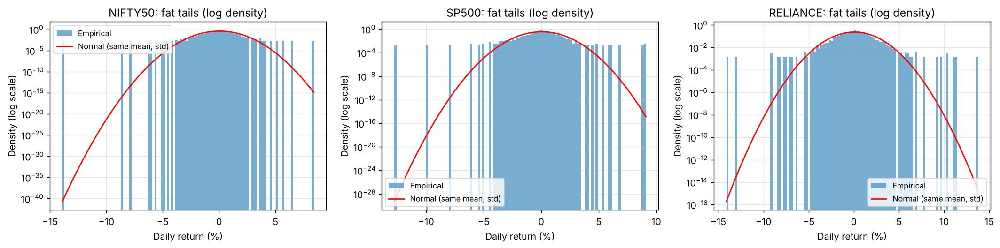
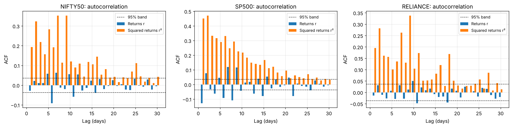
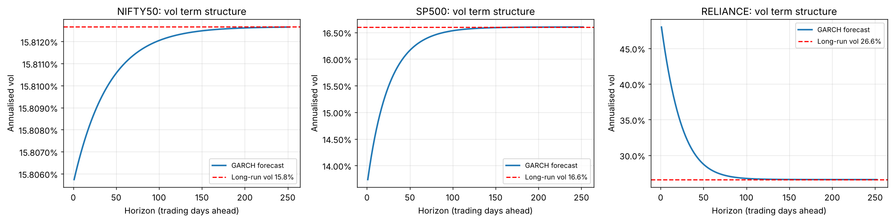
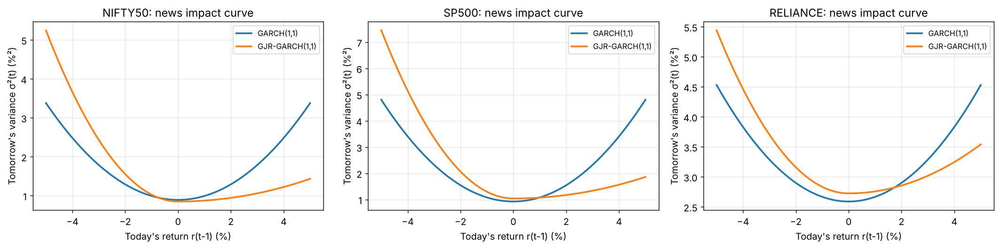
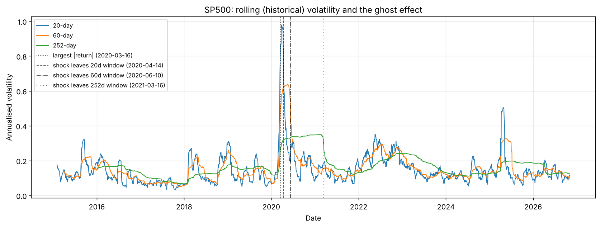
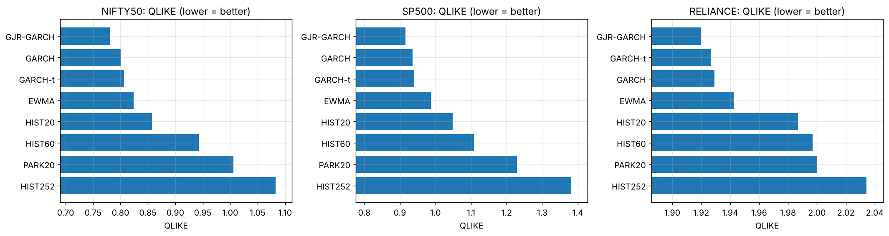
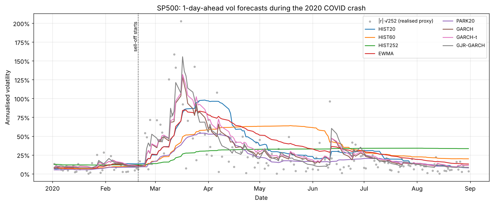

# Volatility Models for Market Risk

Estimate, forecast and compare the volatility of equity returns. The project covers:

- **Data:** Nifty 50 (`^NSEI`), S&P 500 (`^GSPC`) and Reliance Industries (`RELIANCE.NS`), daily, 2015 → latest, from Yahoo Finance.
- **Part 1 — stylized facts:** fat tails, volatility clustering and the leverage effect, which together explain why constant volatility is wrong.
- **Part 2 — models:**
  - rolling 20/60/252-day volatility
  - EWMA (RiskMetrics, λ = 0.94)
  - GARCH(1,1), estimated by hand with MLE and with `arch`
  - GARCH with Student-t errors
  - GJR-GARCH (leverage effect)
  - Parkinson range-based volatility
- **Part 3 — honest out-of-sample evaluation:**
  - expanding window, with GARCH-type models refit every 20 days and no look-ahead
  - MSE and QLIKE losses against $r_t^2$
  - Mincer–Zarnowitz regressions
  - model ranking per asset
  - a zoom on the 2020 COVID crash
- **Export:** `outputs/vol_forecasts.csv` (date, asset, model, sigma_daily, sigma_annual) for downstream VaR backtesting.

Every line is meant to be explainable in an interview. See [MATH.md](MATH.md), [LEARNING.md](LEARNING.md) and [INTERVIEW_DEFENSE.md](INTERVIEW_DEFENSE.md).

---

> **Status:** complete. Results are from real Yahoo Finance data, 2015-01-01 → 2026-11-04 (run on 2026-11-04). All 24 tests pass, and the notebook is committed executed.

---

## How to run

Install the dependencies:

```bash
cd volatility-models
pip install -r requirements.txt
```

Run the full pipeline (downloads once to `data/`, then works offline; about 2–5 minutes):

```bash
python main.py
```

Run the unit tests (synthetic inputs only):

```bash
python -m pytest -q
```

Execute the interview walkthrough notebook:

```bash
jupyter nbconvert --to notebook --execute --inplace notebooks/walkthrough.ipynb
```

Print the hand-computable examples used in MATH.md:

```bash
python -m src.worked_examples
```

If the download fails, `main.py` falls back to `data/NSEI.csv`, `data/GSPC.csv` and `data/RELIANCE_NS.csv`. If those do not exist either, it prints `STOP` and exits with code 1.

---

## Project structure

```
volatility-models/
  data/                  cached raw prices (CSV, yfinance format)
  src/
    config.py            all parameters in one @dataclass
    data_loader.py       download, cache, clean, log returns
    stylized_facts.py    summary stats, Jarque-Bera, ACF, Ljung-Box, leverage
    models/
      historical.py      rolling 20/60/252-day volatility (+ ghost effect)
      ewma.py            RiskMetrics EWMA (loop == pandas .ewm)
      garch_manual.py    GARCH(1,1) log-likelihood + scipy MLE by hand
      garch_arch.py      GARCH normal/t, GJR-GARCH, news impact, term structure
      parkinson.py       range-based volatility
    evaluation.py        rolling OOS forecasts, MSE, QLIKE, Mincer-Zarnowitz, COVID
    plots.py             all charts
    worked_examples.py   numbers used in MATH.md
  notebooks/walkthrough.ipynb   top-to-bottom interview demo
  tests/                 pytest (synthetic inputs only)
  outputs/               charts (PNG), tables (CSV), key_results.json, vol_forecasts.csv
  main.py                one command runs everything
```

---

## Outputs produced by `main.py`

| File | Content |
|------|---------|
| `data_cleaning.csv` | rows dropped per asset and per rule |
| `stylized_facts.csv`, `ljung_box.csv` | Part 1 statistics and tests |
| `01_returns_clustering.png` … `04_acf_returns_vs_squared.png` | Part 1 charts |
| `05_hist_vol_*.png` | rolling vols and the ghost effect |
| `06_ewma_weights.png`, `07_ewma_lambdas_*.png` | EWMA charts |
| `garch_manual_vs_arch.csv` | manual MLE vs `arch` |
| `garch_params.csv` | estimates, robust SE, t-stats, p-values (GARCH-N, GARCH-t, GJR) |
| `garch_summary.csv` | persistence, long-run variance/vol, half-life, ν, γ test |
| `garch_information_criteria.csv` | log-likelihood, AIC, BIC |
| `08_garch_term_structure.png`, `09_news_impact_curve.png` | GARCH charts |
| `10_parkinson_*.png` | Parkinson vs close-to-close |
| `model_ranking.csv`, `rank_summary_qlike.csv` | MSE / QLIKE and ranks |
| `13_qlike_by_model.png`, `14_mse_by_model.png` | loss charts |
| `mincer_zarnowitz.csv` | a, b, HAC SEs, R², joint p-value |
| `covid_reaction.csv`, `12_covid_zoom_*.png` | COVID reaction speed and decay |
| `11_oos_forecasts_*.png` | out-of-sample forecasts |
| `vol_forecasts.csv` | every 1-day-ahead forecast (date, asset, model, sigma_daily, sigma_annual) |
| `key_results.json` | every number quoted in the docs |

---

## Key results

All numbers below come from `outputs/` (CSV / `key_results.json`) produced by `python main.py`.

### Part 1 — stylized facts (`stylized_facts.csv`)

| | NIFTY50 | SP500 | RELIANCE |
|---|---|---|---|
| Daily returns used | 2,914 | 2,976 | 2,921 |
| Rows dropped in cleaning | 0 | 0 | 2 (High = Low) |
| Annualised vol | 16.3% | 17.7% | 27.0% |
| Skewness | −1.29 | −0.64 | +0.17 |
| Excess kurtosis | 19.6 | 15.9 | 8.5 |
| Jarque–Bera (p-value) | 47,200 (≈0) | 31,567 (≈0) | 8,779 (≈0) |
| 4σ days: observed vs normal | 16 vs 0.18 | 22 vs 0.19 | 18 vs 0.19 |
| Ljung–Box Q(20): $r$ vs $r^2$ | 94 vs 2,009 | 288 vs 3,706 | 40 vs 1,468 |
| corr($r_t$, $\lvert r_{t+1}\rvert$) | −0.050 | −0.120 | −0.010 |
| corr($r_t$, $r_{t+1}^2$) | +0.048 | −0.078 | +0.025 |

What the table shows:

- **Fat tails:** 4σ days happen about 100 times more often than a normal distribution allows.
- **Clustering:** squared returns are 7–37 times more autocorrelated than returns.
- **Leverage:** the absolute-return correlation is negative for all three assets. The squared-return version is negative only for SP500, because squaring lets the March-2020 crash-and-rebound days dominate. GJR's γ (below) is the more robust test, and it is significant for all three.




### Part 2 — models (`garch_summary.csv`, `garch_information_criteria.csv`, `garch_params.csv`)

| GARCH(1,1), normal errors | NIFTY50 | SP500 | RELIANCE |
|---|---|---|---|
| α / β | 0.099 / 0.877 | 0.155 / 0.809 | 0.078 / 0.871 |
| Persistence α+β | 0.976 | 0.964 | 0.948 |
| Half-life (days) | 28.6 | 18.9 | 13.1 |
| Long-run annual vol | 15.8% | 16.6% | 26.6% |
| Next-day vol at end of sample | 15.8% | 13.7% | 48.0% |
| Student-t ν | 7.0 | 5.8 | 5.2 |
| AIC: normal → t | 7,476 → 7,345 | 7,699 → 7,518 | 10,975 → 10,703 |
| GJR γ (t-stat, p) | 0.153 (4.24, <0.001) | 0.224 (4.98, <0.001) | 0.076 (2.42, 0.016) |

Other model results:

- **Manual MLE vs `arch`** (same backcast): the largest parameter difference is 4×10⁻⁶, and the log-likelihoods match.
- **EWMA = GARCH special case:** the code checks that GARCH with ω = 0, α = 0.06, β = 0.94 reproduces the EWMA path exactly on the real data.
- **Parkinson vs close-to-close (20-day):** Parkinson is 16% / 19% / 8% lower. The overnight gap carries 40% / 21% / 23% of return variance, and Parkinson cannot see it.
- **Rolling windows (SP500):** the 20-day estimate changes by 0.58 vol points per day, against 0.06 for the 252-day estimate.
- **Reliance's 48% next-day vol** comes from a genuine +11.0% day on 2026-11-02, on about 7 times the median volume.





### Part 3 — out-of-sample ranking (`model_ranking.csv`, `rank_summary_qlike.csv`)

The out-of-sample period is about 1,900 days per asset, starting Dec-2018 / Jan-2019. GARCH-type models are refit every 20 days. The table shows QLIKE, with the rank in brackets (lower QLIKE is better):

| Model | NIFTY50 | SP500 | RELIANCE | Mean QLIKE rank |
|---|---|---|---|---|
| **GJR-GARCH** | **0.781 (1)** | **0.916 (1)** | **1.920 (1)** | **1.0** |
| GARCH | 0.801 (2) | 0.936 (2) | 1.929 (3) | 2.3 |
| GARCH-t | 0.806 (3) | 0.941 (3) | 1.927 (2) | 2.7 |
| EWMA (λ=0.94) | 0.824 (4) | 0.987 (4) | 1.943 (4) | 4.0 |
| HIST20 | 0.858 (5) | 1.048 (5) | 1.987 (5) | 5.0 |
| HIST60 | 0.943 (6) | 1.108 (6) | 1.997 (6) | 6.0 |
| PARK20 | 1.006 (7) | 1.229 (7) | 2.000 (7) | 7.0 |
| HIST252 | 1.083 (8) | 1.381 (8) | 2.034 (8) | 8.0 |

How to read the evaluation:

- **MSE winner:** GJR-GARCH for NIFTY50 and RELIANCE, GARCH for SP500.
- **Mincer–Zarnowitz:** SP500 GARCH has b = 0.995 (joint p = 0.62, R² = 0.29), essentially unbiased. Every rolling window rejects a = 0, b = 1 (p ≤ 0.03), with b = 0.34–0.65.
- **COVID, SP500** (`covid_reaction.csv`):
  - GARCH went from 9.7% to 128.5% in 18 trading days and was back halfway to its pre-shock level after 10 more days.
  - EWMA peaked at 84.8% after 24 days and took 30 days to come back halfway.
  - HIST252 peaked at only 34.0%, 112 days later.




`outputs/vol_forecasts.csv` holds 46,488 rows: 3 assets × 8 models, dated 2018-12-24 → 2026-11-04.

---

## Summary of findings

1. Constant volatility is rejected: kurtosis of 8.5–19.6, about 100 times more 4σ days than normal, and Ljung–Box Q on $r^2$ of 1,468–3,706.
2. GARCH persistence is 0.95–0.98, so shocks have a half-life of 13–29 days. Long-run vol is about 16% for the indices and 27% for Reliance.
3. Student-t errors fit far better in sample (AIC lower by 131–273), with ν = 5–7. But they do not improve the out-of-sample variance forecast.
4. The leverage effect is significant everywhere (GJR γ t-stat 2.4–5.0), and strongest for the indices.
5. **GJR-GARCH is the best 1-day forecaster on QLIKE for all three assets.** The ordering is stable: GARCH family, then EWMA, then rolling windows, with Parkinson near the bottom because of overnight gaps.
6. In crashes, GARCH reacts fastest and also mean-reverts fastest. EWMA reacts fast but decays slowly. Long windows are useless.

**Not completed:** nothing from the brief is outstanding. The improvements listed in INTERVIEW_DEFENSE.md (EGARCH, DCC, intraday realised vol, implied vol, Diebold–Mariano) are out of scope.
